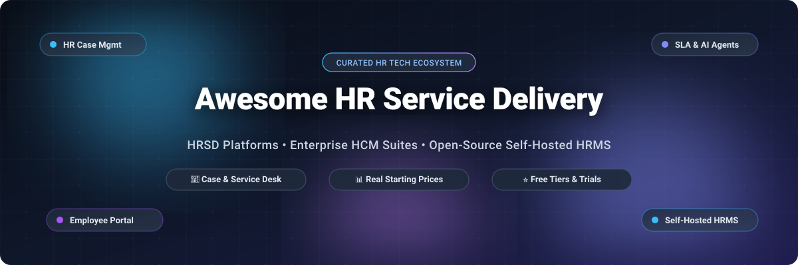

<p align="center">
  
</p>

# Awesome HR Service Delivery (HRSD) 🚀

<p align="center">
  <a href="https://github.com/ishandutta2007/Awesome-Awesome-Awesome"></a>
  <a href="https://discord.gg/jc4xtF58Ve"></a>
  <a href="https://github.com/ishandutta2007/Awesome-HR-Service-Delivery-HRSD/stargazers"></a>
  <a href="https://github.com/ishandutta2007/Awesome-HR-Service-Delivery-HRSD/network/members"></a>
  <a href="https://github.com/ishandutta2007/Awesome-HR-Service-Delivery-HRSD/pulls"></a>
  <a href="https://github.com/ishandutta2007"></a>
</p>

---

## 📌 Executive Summary & Scope

**Curated List of SaaS Platforms & Open-Source Repositories for HR Service Delivery (HRSD), Human Capital Management (HCM) & HR Operations Automation.**  

*Empowering People Operations, HRIS Administrators, and DevOps Engineers to streamline HR case management, employee self-service (ESS), SLA-driven lifecycle workflows, and sovereign self-hosted infrastructure.*

**Last updated: October 2026**

This repository curates notable **commercial SaaS platforms** and **active open-source projects** in **HR Service Delivery (HRSD)**. These solutions enable modern enterprises and fast-growing startups to treat HR inquiries with the same operational rigor, compliance posture, and automation discipline as IT Service Management (ITSM). Core capabilities include:
- 🎯 **HR Case Management & Service Catalogs**: Ticket lifecycle management categorized by Centers of Excellence (COEs: Benefits, Payroll, Employee Relations, Onboarding).
- 🤖 **AI-Assisted Knowledge Bases & Virtual Agents**: Automated self-service deflection, document summarization, and employee request routing.
- 🔄 **Lifecycle Orchestration**: Cross-departmental onboarding, offboarding, leave approvals, and compliance tracking.
- 🔒 **Data Sovereignty & Self-Hosting**: Open-source HRMS platforms that avoid per-employee lock-in and safeguard sensitive employee records.

---

## 📑 Table of Contents

- [🌐 Sector Overview & Market Dynamics](#-sector-overview--market-dynamics)
- [🏢 SaaS & Hosted Platforms](#-saas--hosted-platforms)
- [🛠️ Open-Source GitHub Projects](#️-open-source-github-projects)
- [📐 HRSD Tiered Architecture Model](#-hrsd-tiered-architecture-model)
- [🤝 How to Contribute](#-how-to-contribute)
- [📈 Star History](#-star-history)
- [💖 Support & Community](#-support--community)
- [⚖️ Disclaimer](#️-disclaimer)

---

## 🌐 Sector Overview & Market Dynamics

The global **HR Service Delivery (HRSD)** and **Human Capital Management (HCM)** software market is valued at approximately **$23.5B to $31.5B in 2026** and is projected to surpass **$60B+ by 2030**, expanding at a Compound Annual Growth Rate (CAGR) of **10.5% to 14.4%** fueled by AI-driven case automation and cloud modernization.

From a competitive standpoint, the sector displays **bifurcated market concentration**:
1. **Enterprise Tier (High Concentration / Oligopoly)**: At the Global 2000 level, the market is heavily consolidated among a small set of dominant giants (Oracle, SAP, ServiceNow, ADP, and Workday). These enterprise suites benefit from high switching costs, deep compliance moats, and unified platform architectures that make enterprise replacement rare.
2. **SMB & Mid-Market Tier (Moderate Fragmentation)**: For businesses with under 2,000 employees, the sector is moderately fragmented with fierce competition between agile modern suites (Rippling, Personio, BambooHR, and TriNet Zenefits), alongside rapidly expanding self-hosted open-source options for teams demanding absolute data residency.

---

## 🏢 SaaS & Hosted Platforms

The table below benchmarks the top commercial HRSD and HCM platforms. Entries are **sorted descending by company scale** (Market Capitalization for publicly traded companies, or latest verified valuation for private companies).

| Platform | Company Scale (Valuation / Revenue) | Description & Key Capabilities | Specific Starting Pricing Tier | Free Tier / Free Trial Limits |
| :--- | :--- | :--- | :--- | :--- |
| **[Oracle Fusion Cloud HCM](https://www.oracle.com/)** | 🏛️ **~$450B – $500B** Market Cap<br>📈 **~$53B – $57B** Rev *(NYSE: ORCL)* | Global enterprise HR platform covering Workforce Deployment, Enterprise Profiles, Legal/Org Structures, Absence Management, Time and Labor, and HCM Data Loader for bulk operations. | **$13.00 – $15.00 per hosted employee/month (PEPM)** list price for Global Human Resources (Core HR); typically requires a **500 – 1,000 employee minimum** and a 3-year enterprise agreement (negotiated volume discounts run 30% – 50% off list). | **No self-service SaaS free trial.** Offers untimed interactive browser-based guided tours on oracle.com; structured 14-to-30-day proof-of-concept (PoC) sandboxes available via sales consultation (standard OCI $300 credit trial excludes Fusion SaaS). |
| **[SAP SuccessFactors](https://www.sap.com/)** | 🏛️ **~$260B – $280B** Market Cap<br>📈 **~$34B – $36B** Rev *(NYSE: SAP)* | Cloud Human Experience Management (HXM) suite with Employee Central for global master data, Onboarding, Performance & Goals, Compensation, Learning, and Story Reports analytics; integrated Joule AI copilot. | **$6.30 – $8.00 per employee/month (PEPM)** (~£4.70/user/month on G-Cloud) for Employee Central; direct enterprise contracts enforce a **1,000-user minimum purchase quantity** (~$75,600/year base software fee). | **30-day free trial** on sap.com. Full access to a shared tenant pre-loaded with sample demo data (limited to core HR self-service, org chart browsing, time-off requests, and goal setting; English only, no administrative config or data export). |
| **[ServiceNow HR Service Delivery](https://www.servicenow.com/)** | 🏛️ **~$160B – $180B** Market Cap<br>📈 **~$13.3B – $14.7B** Rev *(NYSE: NOW)* | Dedicated enterprise HRSD platform on the Now Platform featuring HR Case Management structured across Centers of Excellence (COEs). Features AI resolution notes, DocIntel attachment extraction, skill sensing, and Alumni Center. | **~$100 – $180 per fulfiller/agent/month** (or ~$6 – $12 per employee/month for employee self-service access) on HRSD Standard/Professional; enterprise contracts typically require a minimum annual commitment of **$20,000 – $30,000/year** (3-year term). | **No production free trial.** Offers a free **Personal Developer Instance (PDI)** via the ServiceNow Developer Program (1 sandbox instance, auto-reclaimed after 10 days of inactivity; restricted to non-production dev/testing of HRSD plugins without SLA), plus interactive web tours. |
| **[ADP Workforce Now](https://www.adp.com/)** | 🏛️ **~$115B – $125B** Market Cap<br>📈 **~$19.2B – $20.0B** Rev *(NASDAQ: ADP)* | Mid-market to enterprise payroll and HCM platform featuring the ADP WorkForce Suite with global time & attendance, absence management, multi-country compliance, and predictive workforce analytics across 140+ countries. | **~$18 – $30 per employee/month (PEPM)** on the Select baseline tier (covers core payroll and HR management; typically for 50+ employees); one-time implementation fee typically runs 10% – 20% of first-year contract value. | **No self-service free trial or free-for-ever tier.** Provides free self-guided interactive video tours and scenario click-paths on adp.com (demonstrating payroll runs and workforce analytics), plus personalized live sales demos. |
| **[Workday HCM](https://www.workday.com/)** | 🏛️ **~$65B – $75B** Market Cap<br>📈 **~$8.4B – $9.0B** Rev *(NASDAQ: WDAY)* | Enterprise cloud HCM platform unifying core HR, payroll, recruiting, talent management, learning, and workforce planning. Features Skills Cloud (intelligent skills foundation) and AI agents operating on unified employee graphs. | **~$34 – $42 per employee/month (PEPM)** for baseline Core HCM (annualized at ~$96 – $504/employee/year depending on bundled modules), with enterprise annual contract minimums starting around **$100,000/year** (3-to-5-year agreement terms). | **No self-service free trial for core HCM.** Provides free interactive, agent-led simulated workflow demos on workday.com (covering HR and payroll journeys) and customized 1-on-1 sales demos. (Note: A separate 30-day trial is restricted solely to Workday Adaptive Planning). |
| **[UKG Pro](https://www.ukg.com/)** | 🦄 **~$35B** Valuation (Private)<br>📈 **~$4.3B – $4.5B** Rev *(Hellman & Friedman)* | Enterprise HCM and workforce management suite (Gartner Magic Quadrant Leader) integrating HR, payroll, talent, advanced scheduling, timekeeping, and compliance with AI-assisted analytics and UKG Wallet earned-wage access. | **~$26 – $41 per employee/month (PEPM)** for enterprise core HCM and workforce management packages (commonly for 1,000+ employees; multi-year 3–5 year agreements); implementation fees typically add 40% – 70% of first-year software fees. | **No public self-service free trial or free tier.** Prospective clients evaluate via scheduled personalized live demos conducted by sales solution engineers, alongside recorded feature walkthrough sessions. |
| **[Rippling](https://www.rippling.com/)** | 🦄 **$13.5B** Valuation (Series F)<br>📈 **~$350M – $400M** ARR *(Private)* | All-in-one HCM built on a unified data layer (Employee Graph) covering HR, payroll, benefits, time tracking, and compliance across 180+ countries; automates onboarding/offboarding and flags compliance risks across 650+ integrations. | **$8 per employee/month (PEPM)** plus a **$35/month base platform fee** for the Unity Core HR platform (covers employee directory, onboarding, and document management; payroll and time tracking are additional modular add-ons). | **No general free trial for full core HR/payroll suite.** Offers untimed browser-based interactive click-through demo sandboxes and a **14-day free trial limited specifically to the Rippling IT Cloud module** (device & identity management); full platform evaluation requires a scheduled guided demo. |
| **[Personio](https://www.personio.com/)** | 🦄 **$8.5B** Valuation (Private)<br>📈 **~$150M+** ARR *(Private)* | European all-in-one HR platform for SMBs with Core HR, Payroll, Performance & Development, Surveys, and Analytics; features an AI Assistant for employee self-service, payslip parsing, and career frameworks. | **€7.60 per employee/month (PEPM)** for companies with 50+ employees (Core plan); **€14.00 per employee/month (PEPM)** for companies with 10–49 employees (Core + Payroll bundle); subject to a 12-month minimum contract and tiered implementation fee. | **14-day free trial** (no credit card required). Full access to Core HR sandbox with sample/uploaded employee data; capped at 3 e-signature requests, 50 survey participants, 5MB document storage per employee; external job board publishing and payroll processing disabled. |
| **[Zenefits](https://www.zenefits.com/)** | 🏛️ **~$5.5B – $6.2B** Market Cap<br>📈 **~$5.0B** Rev *(TriNet / NYSE: TNET)* | Consolidated HR platform (TriNet Zenefits) for SMBs combining automated onboarding, employee management, scheduling, time tracking, and benefits administration in a single dashboard. | **$8 per employee/month (PEPM)** billed annually (or **$10 PEPM** billed monthly) on the Essentials tier; subject to a mandatory **5-employee minimum billing threshold** ($40/month minimum; payroll is an optional $6 PEPM add-on). | **No self-service free trial or free-for-ever plan** (legacy 14-day trial discontinued). Offers free interactive guided tour walkthroughs and scheduled live sales demos; accounts require the 5-seat minimum billing upon signup. |
| **[BambooHR](https://www.bamboohr.com/)** | 🦄 **~$3.0B – $4.0B** Valuation (Private)<br>📈 **~$250M+** ARR *(Private)* | HRIS designed for small to mid-sized businesses with employee records, automated onboarding/offboarding, time-off tracking, document management, and employee self-service portal. | **$250/month flat fee** for up to 25 employees, or **$10.00 – $10.25 per employee/month (PEPM)** for companies with >25 employees on the Core tier. (Payroll, Benefits, and Time Tracking sold as modular add-ons). | **7-day free trial** (no credit card required). Includes full access to a Core HR sandbox pre-populated with demo sample data, employee directories, onboarding checklists, time-off tracking, and mobile app; live payroll processing and benefits administration add-ons are excluded. |

---

## 🛠️ Open-Source GitHub Projects

Open-source and self-hosted HRMS projects provide organizations with total data sovereignty, zero per-employee licensing lock-in, and granular auditability.

All repositories are **sorted descending by GitHub Stars_Count**. Each repo badge links directly to its stargazer community.

1. **[Odoo HR](https://github.com/odoo/odoo)** [](https://github.com/odoo/odoo/stargazers)  
   *Comprehensive Open-Source Business & Operations Suite (LGPL-3.0 | Python/JS)*  
   Modular open-source ERP with integrated HR applications covering Employee Directory, Leave & Absence Management, Recruitment (ATS), Time Off, Appraisals, and Expense Tracking. Integrates natively with accounting and payroll modules.

2. **[Frappe HRMS](https://github.com/frappe/hrms)** [](https://github.com/frappe/hrms/stargazers)  
   *Modern, Feature-Rich HR & Payroll Framework (GPL-3.0 | Python/Vue)*  
   Built on the Frappe Framework (same foundation as ERPNext). Delivers end-to-end employee lifecycle management, automated attendance, multi-tier shift scheduling, expense claim approvals, performance appraisal cycles, and automated tax calculations.

3. **[Ever Gauzy](https://github.com/ever-co/ever-gauzy)** [](https://github.com/ever-co/ever-gauzy/stargazers)  
   *Open Business Management, ERP & HRM Platform (Apache-2.0 / Fair-Code | TypeScript/NestJS/Angular)*  
   Tailored for distributed organizations, agencies, and modern remote teams. Includes employee time tracking, automated payroll calculations, project assignments, candidate pipeline management, and role-based permissions.

4. **[Dolibarr ERP & HRM](https://github.com/Dolibarr/dolibarr)** [](https://github.com/Dolibarr/dolibarr/stargazers)  
   *Mature Self-Hosted Enterprise Suite (GPL-3.0 | PHP/MySQL)*  
   Robust open-source suite featuring dedicated HR modules for managing employee master records, holiday and leave requests, expense reports, timesheets, and candidate applications.

5. **[GLPI](https://github.com/glpi-project/glpi)** [](https://github.com/glpi-project/glpi/stargazers)  
   *ITIL Service Desk, Asset Management & Shared Service Delivery (GPL-3.0 | PHP)*  
   Widely deployed across IT and HR shared services to manage employee onboarding/offboarding hardware provisioning, HR ticket workflows, service catalogs, and SLA enforcement.

6. **[erxes XOS](https://github.com/erxes/erxes)** [](https://github.com/erxes/erxes/stargazers)  
   *Open-Source Experience Operating System (GPL-3.0 | TypeScript/Node/React)*  
   Unifies internal team collaboration, employee helpdesk ticketing, shared multi-channel inboxes, task management, and automated workflow triggers across departments.

7. **[Horilla HRMS](https://github.com/horilla-opensource/horilla)** [](https://github.com/horilla-opensource/horilla/stargazers)  
   *Full-Lifecycle HRMS with Built-in HR Helpdesk (LGPL-3.0 | Python/Django)*  
   Feature-complete HRMS covering employee directory, LDAP authentication, recruitment pipelines, onboarding/offboarding task checklists, biometric attendance syncing, leave policy rules, asset tracking, and a dedicated ticketing service desk (`horilla/horilla-hr:2.1.5`).

8. **[OrangeHRM](https://github.com/orangehrm/orangehrm)** [](https://github.com/orangehrm/orangehrm/stargazers)  
   *Pioneering Enterprise Human Resource Management (GPL-3.0 | PHP/Symfony)*  
   One of the earliest and most proven open-source HR systems (active since 2005). Provides Personnel Information Management (PIM), leave/time-off tracking, attendance management, performance reviews, and candidate recruitment.

9. **[Urlaubsverwaltung](https://github.com/urlaubsverwaltung/urlaubsverwaltung)** [](https://github.com/urlaubsverwaltung/urlaubsverwaltung/stargazers)  
   *Dedicated Self-Hosted Absence & Leave Management (Apache-2.0 | Java/Spring Boot)*  
   Streamlined web application dedicated exclusively to vacation requests, sick day notifications, overtime hours calculation, and departmental calendar synchronization.

10. **[OpenHRApp](https://github.com/mimnets/OpenHRApp)** [](https://github.com/mimnets/OpenHRApp/stargazers)  
    *Lightweight Self-Hosted HR & Attendance Tracker (MIT | React/Supabase)*  
    Clean, privacy-first web application designed for small organizations requiring basic employee attendance tracking, employee directory, and leave logging.

11. **[HRKit](https://github.com/AnitChaudhry/HRKit)** [](https://github.com/AnitChaudhry/HRKit/stargazers)  
    *Local-First AI-Assisted HR Management (MIT | Python/SQLite)*  
    Local-first HR tool with 11 modules (Documents, Leave, Attendance, Payroll, Performance, Onboarding, Exits, and Recruitment with AI candidate scoring). Integrates BYOK (Bring Your Own Key) OpenAI-compatible LLMs and per-employee folder structures.

12. **Sentrifugo**  
    *Community Classic HR Management (GPL-3.0 | PHP)*  
    Traditional open-source HRMS with modules for employee records, performance appraisals, background checks, leave tracking, and exit interviews (available via community archives).

---

## 📐 HRSD Tiered Architecture Model

Enterprise HR Service Delivery organizes employee operations across a **4-tier service delivery model**:

```
[ Tier 0: Employee Self-Service ]
  ├── AI Virtual Agents & Chatbots (Now Assist, Joule)
  ├── Searchable Knowledge Base (FAQs, Policies, Handbooks)
  └── Employee Experience Portal (Requests, Profile Updates)
           │ (Unresolved Inquiries Escalate)
           ▼
[ Tier 1: HR Shared Services / Contact Center ]
  ├── First-Contact Resolution Specialists
  ├── Standard Verification Letters & Policy Guidance
  └── SLA-Driven Helpdesk Ticketing (Horilla, ServiceNow, GLPI)
           │ (Complex / Sensitive Cases Escalate)
           ▼
[ Tier 2: Centers of Excellence (COEs) ]
  ├── Payroll Specialists & Tax Analysts
  ├── Benefits & Health Plan Administrators
  ├── Talent Acquisition & Onboarding Coordinators
  └── Employee Relations & Dispute Investigators
           │ (Strategic / Exception Review)
           ▼
[ Tier 3: Strategic HR Business Partners (HRBPs) & Legal ]
  ├── Workforce Restructuring & Executive Leadership
  ├── Labor Law Compliance & Legal Counsel
  └── Strategic Organization Design
```

---

## 🤝 How to Contribute

Contributions from HR operators, software architects, and open-source contributors are warmly welcomed!

1. **Fork** the repository on GitHub.
2. **Add or update entries** in [README.md](file:///C:/Users/hp/Documents/Projects/Awesome-HR-Service-Delivery-HRSD/README.md) maintaining the table and badge format.
3. Ensure commercial entries include specific starting pricing and verified free trial/tier limits.
4. For open-source projects, include the repository URL, shields Stars_Badge (`style=social&color=white`) linking to `/stargazers`, tech stack, and primary features.
5. **Submit a Pull Request** with a concise description of your additions.

Explore more curated developer lists at [Awesome-Awesome-Awesome](https://github.com/ishandutta2007/Awesome-Awesome-Awesome).

---

## 📈 Star History

[](https://star-history.dera.page/#ishandutta2007/Awesome-HR-Service-Delivery-HRSD&type=date&legend=top-left)

---

## 💖 Support & Community

Thank you for exploring this curated repository! If this guide helps you benchmark HR tech, evaluate SaaS pricing, or deploy open-source HR infrastructure:

- ⭐ **Star this repository** to support ongoing research and help others discover it.
- 🍴 **Fork the project** and submit additions or corrections.
- 📢 **Share** with your HR operations team, engineering colleagues, and HRIS consultants.
- ☕ **Sponsor / Buy me a coffee:** You can support the curator directly via the [GitHub Sponsors Dashboard](https://github.com/sponsors/ishandutta2007).

---

## ⚖️ Disclaimer

- This is a **community-curated research directory** — not an official endorsement or legal consultation.
- Platforms handling employee personal data must comply with global privacy frameworks (GDPR, CCPA/CPRA, HIPAA) and regional labor regulations; strict access control, data residency, and audit logging are mandatory.
- Open-source implementations require independent security hardening and backup infrastructure prior to handling production personnel data.
- Pricing, tier features, and trial policies reflect vendor disclosures as of late 2026 and are subject to change.

---

<p align="center">
  <b>Built with care for HR operations leaders, PeopleOps engineers, and HRIS architects worldwide.</b><br>
  <i>Empowering modern organizations with efficient, transparent, and employee-centric service delivery.</i>
</p>
